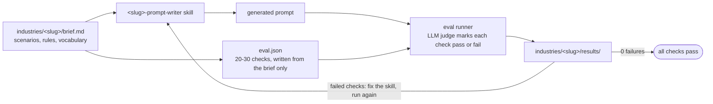

# Industry Prompt Skills

Industry prompt-writing skills for voice AI agents, test-driven with compliance evals.

Each of 8 industries (pharmacy, healthcare, retail, education, logistics, hr, banking, real-estate) gets a skill that writes system prompts for voice and chat agents, and an `eval.json` of 20-30 compliance checks that every generated prompt must pass. The folder is separate from the platform codebase. Merging into the platform is out of scope.

## How it works



## Design decisions

- **Evals are written blind.** `eval.json` is written from the brief, never from the skill, so the skill cannot be tuned to its own tests.
- **Failures change the skill, not the eval.** A hook blocks edits to an approved `eval.json`. An eval changes only if it is wrong, and the reason goes in `docs/DECISIONS.md`.
- **Critical rules cannot be overridden.** A customer can change config values and add rules. A requirement that conflicts with a critical rule is ignored and listed at the end of the generated prompt.
- **Shared baseline rules.** Rules every voice agent needs (AI disclosure, language handling, data minimisation, DPDP) live once in `docs/shared/baseline-rules.md`. Industry briefs keep their own rule IDs and point to them.
- **One eval format.** All industries use the schema in `docs/shared/eval-schema.md`, checked by `scripts/validate_eval.py` locally and in CI.
- **No hard-coded values.** Hospital names, persona names, doctors, fees and similar facts are `{{placeholders}}` in the skill. If a customer gives no value, the prompt says staff will confirm. It never invents one.
- **Synthetic data only.** No real customer, patient or company data anywhere.

## Repo layout

```
industries/<slug>/brief.md            scenarios (S-xx), rules (R-xx), vocabulary, escalation, data handling, open questions
industries/<slug>/eval.json           compliance checks (read-only once approved)
industries/<slug>/results/            saved evaluation runs, one folder per run
.claude/skills/<slug>-prompt-writer/  the industry skill: SKILL.md and references/
.claude/skills/                       workflow skills: grill-me, brainstorm, spec-first, write-evals, run-evals, release-check
.claude/agents/eval-judge.md          the grader that marks each check pass or fail
.claude/hooks/                        blocks edits to approved eval.json files, validates edited ones
docs/shared/baseline-rules.md         rules for every industry's voice agent
docs/shared/eval-schema.md            the eval.json format
docs/DECISIONS.md                     decisions log
scripts/validate_eval.py              validates an eval.json
scripts/status.py                     fills the progress table below from the files
tests/                                pytest suite
.github/workflows/ci.yml              tests, eval validation and README check on every push and pull request
outputs/                              sample generated prompts
```

## Quickstart

Run the commands from the repo root. The skills run inside [Claude Code](https://claude.com/claude-code).

```bash
# Install dev dependencies (pytest)
python -m pip install -r requirements-dev.txt

# Run the tests
python -m pytest -q

# Validate an eval file
python scripts/validate_eval.py industries/<slug>/eval.json

# Generate a prompt for an industry (in Claude Code; pass the customer's requirements)
/healthcare-prompt-writer Hospital: Sunrise Multispeciality Clinic, persona: Asha, languages: English, Hindi

# Run one evaluation round for an industry (in Claude Code)
/run-evals healthcare

# Refresh the progress table, or check it is current
python scripts/status.py
python scripts/status.py --check
```

## Adding a new industry

1. Ask the owner about the industry: `/grill-me <industry>`. The answers go in `docs/DECISIONS.md`.
2. List scenarios, edge cases, risks and attacks: `/brainstorm <industry>`.
3. Write the brief: `/spec-first <industry>`. It saves `industries/<slug>/brief.md` after approval. Rules shared with other industries point to `docs/shared/baseline-rules.md`.
4. Write the evals from the brief: `/write-evals <industry>`. It saves `industries/<slug>/eval.json` with 20-30 checks, and the file is locked after approval.
5. Write the skill in `.claude/skills/<slug>-prompt-writer/` with `SKILL.md` and `references/`. Use `healthcare-prompt-writer` as the pattern.
6. Run the evals: `/run-evals <industry>`. Results are saved in `industries/<slug>/results/`.
7. For each failed check, change the skill (never the eval) and run step 6 again until the latest run has 0 failures.
8. Run `python scripts/status.py`, then `/release-check`, then commit.

## Progress

Generated by `scripts/status.py`. Do not edit the table by hand.

- **Brief**: Done when `brief.md` has no `Status: Todo` line.
- **Skill**: In progress when `.claude/skills/<slug>-prompt-writer/SKILL.md` exists. Done when the latest run has 0 failures.
- **Evals**: the number of cases in `eval.json`. Done when it is approved (locked) and passes `scripts/validate_eval.py`.
- **Last run** and **Pass rate**: from the newest `industries/<slug>/results/<date>-run<N>/summary.json`. Pass rate is Done when it has 0 failures.

<!-- STATUS:START -->
| Industry | Brief | Skill | Evals | Last run | Pass rate |
|---|---|---|---|---|---|
| pharmacy | Done | Done | Done (30) | 2026-10-13 | Done (65/65) |
| healthcare | Done | Done (v1) | Done (30) | 2026-10-13 | Done (v1) (57/58) |
| retail | Todo | Todo | Todo | Todo | Todo |
| education | Todo | Todo | Todo | Todo | Todo |
| logistics | Todo | Todo | Todo | Todo | Todo |
| hr | Todo | Todo | Todo | Todo | Todo |
| banking | Done | In progress | Done (30) | 2026-10-10 | In progress (44/64) |
| real-estate | Todo | Todo | Todo | Todo | Todo |
<!-- STATUS:END -->
